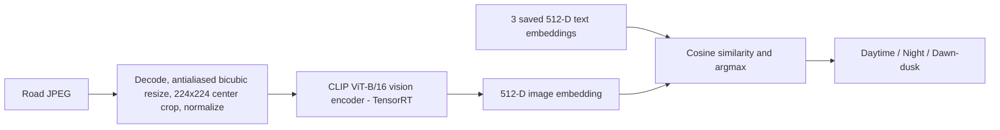

# CLIP ViT-B/16 - Mixed INT8/FP16 TensorRT & C++ Road-Scene Classifier

A reproducible **post-training optimization and deployment** project for a pretrained CLIP vision encoder. Given a road-scene JPEG, the standalone C++ program predicts **daytime**, **night**, or **dawn/dusk** by comparing its image embedding with three fixed text embeddings. It does **not** train CLIP or fine-tune the classifier.

**Tested setup:** NVIDIA Tesla T4, Google Colab Linux, TensorRT 11.4.0.106. A new Colab account with an empty Google Drive workspace successfully ran all six pipeline stages (exit code 0). The clean-room mixed engine achieved **80.67% accuracy (242/300)**; a prior engine achieved **81.33% (244/300)**. Exact TensorRT tactics, timings, and individual predictions are not guaranteed to match after recompilation.

## Results at a glance

| Result | FP32 PyTorch | FP16 TensorRT | Mixed INT8/FP16 TensorRT |
|---|---:|---:|---:|
| Original 300-image accuracy | 81.00% | 80.67% | 81.33% |
| **Fresh clean-room accuracy** | **81.00%** | **80.67%** | **80.67%** |
| Fresh clean-room macro F1 | 0.7991 | 0.7951 | 0.7941 |
| Engine file size, validated prior run | - | 166.14 MiB | **114.42 MiB** |

**31.1% engine-file size reduction** compared with FP16. This is *not* a measured 31.1% GPU-memory reduction. The smaller mixed engine does **not** always run faster: three repeated *previous-session* tests averaged 4.018 vs 3.908 ms at batch 1 (FP16 vs mixed) and 59.40 vs 62.18 ms at batch 32. GPU timing varies between Colab sessions. Full comparisons and provenance are in [Technical report](docs/TECHNICAL_REPORT.md).

**Standalone native C++ deployment** (previous validated application run): **80.67%** accuracy, **33.77 ms** mean JPEG-to-prediction latency, with **24.80 ms** mean CPU preprocessing and **8.71 ms** mean GPU-event execution on locally stored images. The C++ preprocessing is nearly, but not exactly, identical to Python"s. See [C++ guide](docs/CPP_DEPLOYMENT.md).

## What the system does



The text embeddings come from these prompts, **in this fixed order**:

1. `A photograph of a road during daytime`
2. `A photograph of a road at night`
3. `A photograph of a road at dawn or dusk`

Output scores are **cosine similarities, not probabilities**. Prompt wording and label order are part of the model definition.

## Start here: reproduce on Google Colab

**Requirements:** Colab Linux runtime with an NVIDIA GPU (T4 used for measurements), enough Google Drive space for model/data/checkpoints, internet access to Hugging Face, and acceptance of upstream dataset/model terms. A local macOS machine without NVIDIA CUDA cannot build or execute this TensorRT engine.

1. Open a **new Colab notebook** and select **Runtime → Change runtime type → T4 GPU**.
2. Clone this repository (replace `YOUR_USERNAME`):

   ```python
   !git clone https://github.com/YOUR_USERNAME/clip-tensorrt-optimization.git /content/clip-tensorrt-optimization
   ```
3. Install dependencies **from requirements.txt** in that Colab runtime:

   ```python
   %pip install -r /content/clip-tensorrt-optimization/requirements.txt
   ```

   Use Colab"s CUDA-compatible PyTorch; the requirements intentionally do not replace it. If installs alter already imported packages, restart the runtime before proceeding.
4. Mount Google Drive and run all stages. In a *new* empty folder, this downloads source data/weights and generates artifacts:

   ```python
   from google.colab import drive
   drive.mount("/content/drive")
   import os, subprocess, sys
   os.environ["HF_HOME"] = "/content/hf"
   os.environ["HF_HUB_CACHE"] = "/content/hf/hub"
   subprocess.run([
       sys.executable, "-u", "-m", "src.pipeline",
       "--root", "/content/drive/MyDrive/CLIP_Quantization_Project",
       "--stage", "all"
   ], cwd="/content/clip-tensorrt-optimization", check=True)
   ```
5. Review the resulting files in `CLIP_Quantization_Project/results/`. The runner stores calibration/validation manifests, ONNX models, engines, checkpoint, hash records and results under the Drive workspace. **You do not need to provide any existing artifacts.** A first run may take significant time and needs internet/GPU resources.
6. To **resume after a Colab interruption**, rerun the same pipeline invocation with the same `--root`. Valid saved artifacts are reused; tests on incomplete or incompatible outputs trigger the relevant stage. You may also pass `--stage prepare|baseline|quantize|convert|build|evaluate` after prerequisites exist.

The repository also includes [notebooks/run_pipeline.ipynb](notebooks/run_pipeline.ipynb) as a thin Colab entry point. To open it as a notebook, use Colab **File → Open notebook → GitHub**, not the Files side-panel preview. The notebook may install `requirements.txt` automatically; do not install it twice unnecessarily.

For step-by-step explanations, verification, output locations, and troubleshooting, read [Reproduction guide](docs/REPRODUCING.md).

## Deploy the C++ application

The source is [`cpp/main.cpp`](cpp/main.cpp), built with [`cpp/build.sh`](cpp/build.sh). It requires TensorRT **11.4 C++ headers/runtime**, CUDA and OpenCV 4 development files. In a supported Linux NVIDIA GPU environment:

```bash
sudo apt-get update
sudo apt-get install -y g++ libopencv-dev pkg-config
export TRT_INCLUDE_DIR=/path/to/TensorRT-11.4/include
# If the build script cannot detect pip-installed TensorRT libraries:
export TRT_LIB_DIR=/path/to/tensorrt_libs
bash cpp/build.sh
cpp/clip_classifier   /path/to/CLIP_Quantization_Project/phase2_artifacts/clip_attention_fc1_int8_fp16_repaired.engine   /path/to/CLIP_Quantization_Project/cpp_deployment/text_embeddings_fp32.bin   /path/to/road.jpg
```

The last command emits CSV with predicted label, three similarity scores, preprocessing time, GPU execution time, and end-to-end time. The engine and `text_embeddings_fp32.bin` are generated by the Python pipeline (not included as prebuilt files). **Serialized TensorRT engines are hardware/software-specific**; rebuild using the pipeline on a compatible GPU. See [C++ deployment guide](docs/CPP_DEPLOYMENT.md).

## Repository map

```text
src/common.py                artifact hashes, verified copy, configuration
src/pipeline.py              staged dataset, calibration, conversion, build, evaluation
notebooks/run_pipeline.ipynb thin Colab launcher and results viewer
cpp/main.cpp                standalone JPEG-to-label C++17 app
cpp/build.sh                C++ compiler/linker configuration
docs/REPRODUCING.md         full instructions and troubleshooting
docs/TECHNICAL_REPORT.md    methods, evidence, comparisons, limitations
docs/CPP_DEPLOYMENT.md      dependencies, build, usage, timing scope
results/reference_runs.csv  measurements transcribed from completed prior runs
experiments/NOTES.md        early experiment context
tests/                     artifact unit tests and GPU acceptance checklist
```

## Limitations and honest claims

- Only 300 balanced validation images (100 per class); this is a development evaluation, **not** proof of production generalization. Dawn/dusk recall in the clean-room mixed result was **48%**, versus 96% daytime and 98% night.
- The clean-room build succeeded and saved artifacts, but produced **two fewer correct mixed-precision predictions** than the historical engine. Exact numerical reproducibility after TensorRT rebuilding is not promised.
- Small differences in sub-5-ms GPU benchmarks should not be generalized without run-to-run variability. Batch-32 performance can favor FP16 depending on the run.
- The optimized C++ program produces a different preprocessing tensor from Python (very close in pixel space), so C++ predictions must be validated separately. The C++ benchmark reported is from a previous validated run, **not automatically rerun by `--stage all`**.
- GPU inference-only timing excludes decoding, preprocessing, data transfers, engine loading and model build time. Do not conflate it with C++ end-to-end timing.
- No source JPEGs, vendor headers, checkpoint weights, or portable engine binaries are committed; review upstream BDD100K/CLIP/NVIDIA licenses before redistribution. Dataset: `dronefreak/BDD100K-Period-Classification` at pinned revision `47b8bde4a2d808df9208a89cdd10f68b251bcdb4`.

## Acknowledgment

Built with pretrained OpenAI CLIP ViT-B/16, NVIDIA TensorRT and ModelOpt, PyTorch, ONNX, and OpenCV. The trained model and data are third-party resources; this project contributes the quantization/conversion/verification and C++ deployment pipeline.
